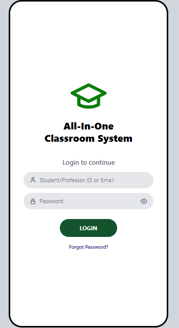
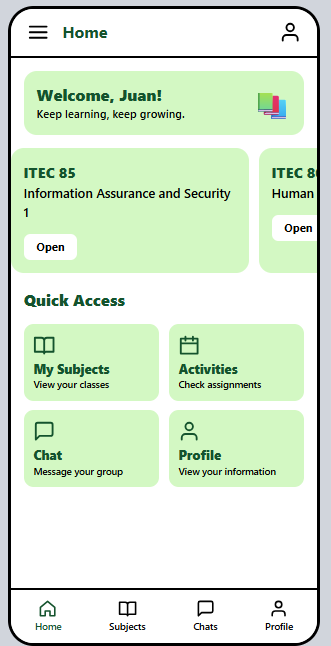
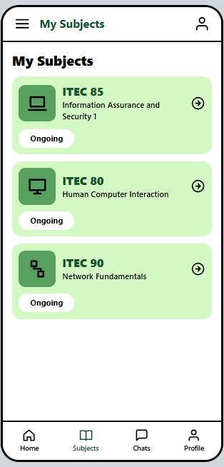
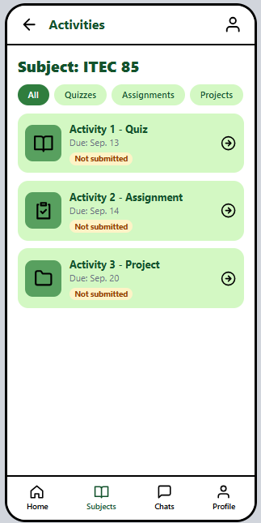
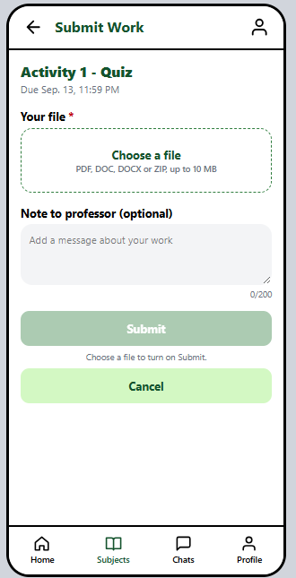
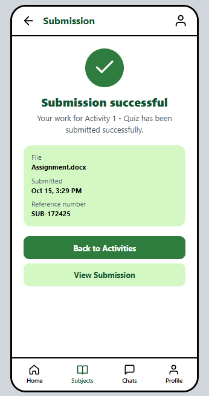

# All-In-One Classroom System

A high-fidelity, interactive mobile prototype for a classroom app where students can view their subjects, check and submit activities, and message their class group chats.

Made for **ITEC 80 (Human Computer Interaction)** at Cavite State University, Tanza Campus.

**Author:** Mark Allen C. Salomon, BSIT
**Live demo:** _add your Vercel / GitHub Pages link here_

> This is a front-end prototype. All data (subjects, professors, activities, chats) is sample data stored in `src/data/index.js`, and login and submissions are simulated.

---

## Screenshots

| Login | Home | My Subjects |
|---|---|---|
|  |  |  |

| Activities | Submit Work | Submission |
|---|---|---|
|  |  |  |

---

## Features

- **Login** screen with the app branding
- **Home** with a welcome card, a swipeable row of subject cards, and Quick Access shortcuts
- **My Subjects** list with each subject's status
- **Subject** page with Overview, Announcements and Activities tabs, the professor's card, and a Video Call button
- **Activities** list with filter chips (All, Quizzes, Assignments, Projects) and a submission status on each item
- **Activity details** with description, steps and due date
- **Submit Work** with a file picker, an optional note to the professor, and a confirmation dialog before submitting
- **Submission successful** screen with the file name, time and a reference number, plus the option to view or remove a submission
- **Chats** list with one group chat per subject, and a working message box
- **Profile** with editable name and email
- **Settings** with notification, reminder and sound toggles and a **dark theme**
- **Responsive layout:** full screen on phones, shown inside a phone frame on larger screens

---

## HCI Requirements Checklist

| Requirement | How the prototype meets it |
|---|---|
| **Consistency** | One green theme, the same header and bottom navigation on every screen, and the same card style for subjects, activities and chats. |
| **Visibility** | Due dates, status pills ("Not submitted"), file details and Quick Access shortcuts are shown on screen. |
| **Feedback** | Toast messages for actions, and a "Submission successful" screen with a check icon, message, file name, time and reference number. |
| **User Control** | Back arrows, Cancel in the submit dialog, an X to remove a chosen file, and a way to remove a submission. |
| **Error Prevention** | A "Submit this work?" confirmation dialog, and a required-file marker on the Submit Work screen. |
| **Clear Navigation** | Screen titles in the header, a highlighted bottom navigation tab, and back arrows that return to the correct parent screen. |
| **Visual Hierarchy** | Large green headings first, details second, and a dark green primary button above lighter secondary buttons. |

---

## HCI / UX Design Considerations

- **Interaction styles:** tap buttons and cards to open pages, type in the login and chat fields, and swipe the subject cards on Home.
- **Navigation and user flow:** Login → Home → My Subjects → Subject → Activities → Activity → Submit Work → Confirmation. Chats and Profile are reachable from the bottom navigation.
- **Feedback:** selected buttons and icons are highlighted in green, "Ongoing" labels show subject status, and confirmation messages appear after successful actions.
- **Sensory channels:** text explains information, icons help users recognize features quickly, and green highlights mark important buttons.
- **Accessibility:** clear labels, icons paired with text, readable text, tap-friendly buttons, and a dark theme option.
- **Consistency:** the same theme, navigation, button styles and layout structure across all screens.

---

## Usability Testing

I tested the prototype by going through the whole user flow and found these issues.

| # | Issue | Heuristic | Status |
|---|---|---|---|
| 1 | The Activities screen showed a menu button instead of a back arrow, so users could not return to their subject. | User control and freedom | Fixed: back arrow added that returns to the selected subject. |
| 2 | Chats in the bottom navigation opened one subject's conversation only. | Flexibility and efficiency of use | Fixed: a Chats list with one conversation per subject. |
| 3 | The Settings and Edit Profile buttons showed a message but opened nothing. | Visibility of system status | Fixed: built a working Settings screen and editable profile. |
| 4 | Small tap targets on the filter chips and bottom navigation labels. | Fitts's law, accessibility | Planned improvement: make tap targets at least 44 px tall. |
| 5 | Every subject shows the same list of activities. | Match between system and the real world | Planned improvement: give each subject its own activity list. |

---

## Tech Stack

- [React](https://react.dev/) 19 with hooks
- [Vite](https://vite.dev/)
- [Tailwind CSS](https://tailwindcss.com/) v4
- Inline SVG icons (no icon library)

---

## Getting Started

**Requirements:** Node.js 18 or newer.

```bash
# 1. Install dependencies
npm install

# 2. Start the dev server
npm run dev
```

Then open `http://localhost:5173`.

**Test on your phone:** run `npm run dev -- --host` and open the Network address it prints (for example `http://192.168.x.x:5173`) on a phone connected to the same Wi-Fi.

**Build for production:**

```bash
npm run build
npm run preview
```

### Deploying to GitHub Pages

`vite.config.js` sets the base path to `/High-Fidelity-Wireframe/` when the `GITHUB_PAGES` environment variable is set. Set it when building for GitHub Pages, and make sure the base path matches your repository name.

Vercel needs no extra setup: import the repository and deploy.

---

## Project Structure

```
Highfidelity/
├── public/
├── src/
│   ├── components/     # Screens and reusable UI (Home, Subject, Activities, Settings, ...)
│   ├── data/
│   │   └── index.js    # Sample subjects, professors, activities, chats, navigation config
│   ├── App.jsx         # Screen switching, shared state, layout frame
│   ├── theme.js        # Color tokens (CSS variables, light and dark)
│   ├── index.css       # Tailwind import and theme variables
│   └── main.jsx
├── index.html
├── vite.config.js
└── package.json
```

### How it works

- `App.jsx` keeps the current screen, selected subject, selected activity, submissions and settings in React state, and `go('screen')` switches between screens.
- Back arrows are defined in one place, the `BACK_TO` map in `App.jsx`.
- Colors come from CSS variables in `index.css`, and the dark theme swaps them with a `dark` class.
- To change subjects, professors, activities or chat messages, edit `src/data/index.js`.

---

## Acknowledgments

Built for the HCI laboratory activity of ITEC 80, Cavite State University, Tanza Campus. The design follows the earlier mid-fidelity wireframe and HCI/UX design considerations submitted for the same project.
